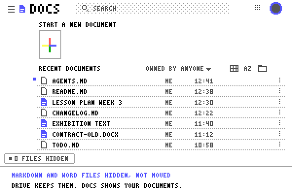

# MD Block for Google Docs



**[Open site](https://seb-prjcts-be.github.io/google_docs_md_filter/)** · **[Install](https://seb-prjcts-be.github.io/google_docs_md_filter/docs/install.html)** · **[Guide](https://seb-prjcts-be.github.io/google_docs_md_filter/docs/guide.html)** · **[Privacy](https://seb-prjcts-be.github.io/google_docs_md_filter/docs/privacy.html)**

A small Chrome extension (Manifest V3) that hides Markdown (`.md`, `.markdown`) and Microsoft Word (`.docx`, `.doc`) files from the Google Docs home screen, its search suggestions and the `File > Open` dialog.

Synced folders in Google Drive put every `.md` and `.docx` on the Docs home screen, next to your native documents. When a coding tool touches a few dozen Markdown files a day, the documents you wanted are a long scroll away. The extension hides those rows in the page (`display: none`). The files stay where they are in Drive, and no extension code runs inside an open document.

It is a workaround in the browser, not a way to switch off Google's integration. The **Enable Markdown** option under `Tools > Preferences` in Docs is about typing Markdown inside a document; it does not change which files the home screen lists. Current release: **0.1.0**.

## Install

The extension is not in the Chrome Web Store yet. Load it from source in Chrome, Brave, Edge, Arc or Vivaldi:

1. Download and unzip the latest zip from [Releases](https://github.com/seb-prjcts-be/google_docs_md_filter/releases), or clone `https://github.com/seb-prjcts-be/google_docs_md_filter.git`.
2. Open `chrome://extensions` and turn on **Developer mode** in the top-right corner.
3. Click **Load unpacked** and choose the folder that holds `manifest.json`.
4. Open or reload `https://docs.google.com/document/`.

A button in the bottom-left corner of the home screen counts what is hidden, for example `14 .md hidden`. Click it to show the hidden files for a while; click again to hide them. [Install](https://seb-prjcts-be.github.io/google_docs_md_filter/docs/install.html) covers updating, removing and what to check when nothing happens.

## Where it runs

- the Google Docs home screen (`docs.google.com/document/`)
- the search suggestions at the top of that screen
- the `File > Open` picker, opened from inside a document

Not in open documents (`/document/d/...`), Google Drive, Sheets, Slides, Forms, the attachment picker in Gmail or any other website. You can still attach a `.md` to an email. [Where it runs](https://seb-prjcts-be.github.io/google_docs_md_filter/docs/guide.html#where) lists the exact addresses.

## Settings

Click the **MD Block** icon in the toolbar. The switch pauses or resumes the filter in every open Docs tab. Markdown and Word are hidden by default; `.txt`, `.json` / `.jsonl`, `.yaml` / `.yml`, `.toml` and `.log` can be ticked, and you can add your own, such as `tex` or `csv`. The counter button can be turned off. [Settings](https://seb-prjcts-be.github.io/google_docs_md_filter/docs/guide.html#settings).

The labels follow the browser language; English and Dutch are included in `_locales/`.

## Limits

The extension hides what Google has already loaded. When many `.md` files sit at the top of Recent Documents, it nudges the page up to fifteen times so older documents come into view; after hundreds of them, scroll once by hand. A native Google Doc whose title ends in `.md` is hidden too, because the title is what the extension reads. [Limits](https://seb-prjcts-be.github.io/google_docs_md_filter/docs/guide.html#limits).

## Test and package

The tests need Node.js and no npm packages:

```bash
node --test test/filter.test.js
```

A clean zip in `dist/` for the Chrome Web Store or a GitHub release, with only `manifest.json`, `_locales/`, `icons/` and `src/`:

```bash
node scripts/pack.js
```

The icons and the animation above are drawn by scripts:

```bash
node scripts/generate-icons.js
node scripts/generate-overview-gif.js
```

The animation asks `src/filter-core.js` which rows to hide and what the button says; the file names in it are invented. `PUBLISHING.md` has the steps for a new release.

Tested with the Node v24.16.0 test suite and on the Google Docs home screen in Chrome on Windows on 2026-10-29.

## Nederlands

Deze extensie werkt alleen in de Google Docs-webapp: op het startscherm (`docs.google.com/document/`), in de zoeksuggesties daarboven en in het venster `Bestand > Openen` vanuit een document. Standaard verbergt ze daar Markdown-bestanden (`.md`, `.markdown`) en Word-bestanden (`.docx`, `.doc`), zodat je tussen je eigen Google-documenten werkt.

Geopende documenten, Google Drive zelf, Sheets, Slides, het bijlagenvenster in Gmail en alle andere websites blijven ongemoeid. Er wordt niets verplaatst of verwijderd. De knop en de instellingen staan in het Nederlands als Chrome op Nederlands staat.

## Licence

MIT, Sebastien Vanblaere. See `LICENSE` and [Privacy](https://seb-prjcts-be.github.io/google_docs_md_filter/docs/privacy.html).

Independent browser extension for the Google Docs web interface; not affiliated with or endorsed by Google LLC.
